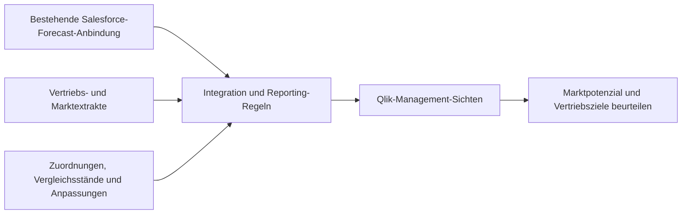

[English](README.md) | **Deutsch**

# Forecast-to-Qlik: Von manueller Vorbereitung zur Management-Beurteilung

**Regionalen Planungsentscheidungen den Marktkontext geben, den eine reine Forecast-Datenanbindung nicht liefern konnte.**

Einer bestehenden Datenanbindung von Salesforce zu Qlik fehlten die zusätzlichen Marktquellen, Prüfungen, Anpassungen und Reporting-Sichten, die das Management benötigte. Jede Aktualisierung erforderte einen separaten Berechnungs- und Upload-Ablauf in Excel.

**Mein Beitrag:** Ich koordinierte die Anforderungen von Ländern, Finance und IT und entwickelte um diese bestehende Anbindung herum die Integration, fachlichen Berechnungen und Validierung. Ich machte Marktdefinitionen, Forecast-Vergleichsstände und den Umgang mit Ausnahmen explizit, damit die Ergebnisse Gespräche über Marktpotenzial und Vertriebsziele unterstützen konnten.

**Ergebnis und Status:** konsistente Forecast- und Marktsichten über neun Länder hinweg, ohne den separaten Berechnungs- und Upload-Schritt in Excel. Das öffentliche Beispiel zeigt ausgewählte Transformationen und Kontrollen mit fiktiven Eingaben. Aktive Systemanbindungen sind ausgeschlossen. Der historische Arbeitsaufwand und die Grenzen der Aktualisierung werden unten erläutert.

[Geschäftliche Fallstudie lesen](https://matthew-bangle-data-portfolio.mattbangle.chatgpt.site/de/work/forecast-to-qlik) · [Öffentliches Beispiel ausführen](#umsetzung-ausführen-und-nachvollziehen)



*Konzeptioneller historischer Ablauf. Der unten beschriebene Code demonstriert ausgewählte Transformationen und Kontrollen mit fiktiven Daten.*

## Was sich für das Geschäft änderte

Das Management konnte Forecast-Aktualisierungen mit dem Marktkontext beurteilen, der für Gespräche über Potenzial und Vertriebsziele nötig war, ohne die separate Excel-Berechnung und den Upload zu wiederholen. Ich hatte diese Vorbereitung selbst durchgeführt: Eine einfache Berechnung mit Upload dauerte etwa **drei Stunden**, bei vielen Änderungen kamen **bis zu fünf weitere Stunden** Validierung hinzu. Dies sind Schätzungen des früheren Arbeitsaufwands und keine feste Einsparung bei jeder Aktualisierung.

Die Integration unterstützte das Reporting für **neun Länder**. Der Aktualisierungszeitpunkt hing von den verbundenen Systemen ab. Das Ergebnis war ein wiederholbarer Weg von aktualisierten Eingaben zur Beurteilung durch das Management.

## Entscheidungen, die das Reporting nutzbar machten

Salesforce-Daten flossen bereits in Qlik. Es fehlten der zusätzliche Marktkontext und konsistente Definitionen für ihre Einordnung. Direkter Zugriff auf das Data Warehouse und die Quelldaten stand mir nicht zur Verfügung. Deshalb arbeitete ich mit verfügbaren Reporting-Extrakten.

| Geschäftliche Frage oder Einschränkung | Gestaltungsentscheidung | Was sie ermöglicht |
| --- | --- | --- |
| Welchen Teil des Markts können wir bedienen? | Gesamtmarkt, adressierbaren Markt und gewichtete Marktsichten explizit halten | Realistischere Gespräche über Potenzial und Vertriebsziele |
| Haben sich Erwartungen seit der Planung verändert? | Aktuelle Forecasts und gespeicherte Vergleichsstände klar unterscheidbar halten | Neue Erwartungen mit einem früheren Stand vergleichen |
| Quellen verwenden unterschiedliche Produkte und Gebiete | Explizite Zuordnungen und Anpassungseingaben pflegen | Leistung nach konsistenten Reporting-Verantwortlichkeiten beurteilen |
| Jährliche Marktschätzungen treffen auf quartalsweise Ist-Werte | Schätzungen verteilen und gleichzeitig beobachtete Quartalswerte des Unternehmens erhalten | Perioden vergleichen, ohne modellierte Quartale als beobachteten Absatz darzustellen |
| Einer Referenzquelle fehlen bestimmte Kategorien | Separate Eingaben für Diagnostik und ergänzende Marktdaten hinzufügen | Reporting-Bedürfnisse abdecken, die eine einzelne Marktquelle nicht erfüllen kann |
| Zahlen und Summen können sich während der Integration verändern | Deklarierte Zahlenkonventionen interpretieren sowie Umfang und Summen abstimmen | Probleme erkennen, bevor ein Ergebnis als verlässlich gilt |

Verweise auf SAP-Vertriebsdaten und Salesforce-Forecasts beschreiben die geschäftliche Herkunft der Daten. Sie bezeichnen keine neuen direkten Konnektoren, die ich gebaut habe. Die [Qlik Reporting Access Bridge](https://github.com/mattbang/qlik-cloud-data-bridge) erläutert die Datenbeschaffung für diese Pipeline. Ihr Nutzen wird nicht separat angerechnet.

## Ein Ergebnis in zwei Minuten prüfen

Die fiktive Demo erhält über drei Szenarien hinweg **997 Einheiten des Unternehmens** und **€5,692 Millionen Unternehmensumsatz**. Der Markt im Nenner verändert sich; die Unternehmenszahlen bleiben konstant.

| Szenario | Markteinheiten | Einheiten des Unternehmens |
| --- | ---: | ---: |
| Gesamtmarkt | 3'790,0 | 997 |
| Adressierbarer Markt | 3'670,0 | 997 |
| Adressierbarer Markt, gewichtet | 2'959,6 | 997 |

Siehe [Datensatz](docs/demo_output/transformed_dataset.csv), [Qualitätsbericht](docs/demo_output/data_quality_report.json) und [Erläuterung der Ausgaben](docs/DEMO_OUTPUT_WALKTHROUGH.md). Dies sind synthetische Demonstrationsergebnisse und keine Zahlen des Arbeitgebers.

## Umsetzung ausführen und nachvollziehen

Python · pandas · NumPy · YAML · Qlik-Reporting-Integration

[](LICENSE)
[](https://github.com/mattbang/enterprise-commercial-etl-pipeline/actions/workflows/ci.yml)

Python 3.10 oder 3.12, entsprechend dem öffentlichen Test-Workflow:

```sh
python -m venv .venv
source .venv/bin/activate  # Windows PowerShell: .venv\Scripts\Activate.ps1
python -m pip install -r requirements-demo.txt
python demo.py
```

Der Lauf schreibt einen Datensatz, eine Szenarioübersicht, einen Qualitätsbericht und eine Zusammenfassung nach `demo_output/`. Dafür ist kein Unternehmenskonto nötig.

Einen absichtlich ausgelösten Fehler untersuchen:

```sh
python demo.py --simulate-capacity-failure --output-dir demo_output/failure_example
```

Neun Demo-Prüfungen bestehen, eine schlägt fehl. Der Lauf endet mit einem Fehlerstatus und veröffentlicht keine CSV-Ausgaben. Dies demonstriert eine ausgewählte Kontrolle und keine umfassende Garantie korrekter Daten.

## Technische Belege und Betriebsgrenzen

- **Transformation:** Python, pandas, NumPy und YAML für Zuordnungen, Szenarien und Berechnungen.
- **Qualität:** Datenverträge, Verarbeitung von Zahlenformaten sowie Prüfungen auf Mengenerhalt und Abstimmung.
- **Betrieb:** dokumentierte Konfiguration, Prozessmodelle und Übergabehinweise.
- **Öffentliche Tests:** `python -m pip install -r requirements-test.txt`, danach `python -m pytest -q`.

Der öffentliche Referenz-Orchestrator für den Produktivbetrieb benötigt unveröffentlichte Konnektoren und Konfiguration. Für den unterstützten öffentlichen Ablauf ist `demo.py` vorgesehen. Die aktuellen Kontrollen vor dem Neuladen können den letzten gültigen lokalen Datensatz erhalten. Nachgelagerte Verifikation findet nach dem Neuladen statt und kann nicht garantieren, dass eine spätere Abweichung zu keinem Zeitpunkt sichtbar war. Fehlende Verifikation führt zu einem nicht verifizierten Ergebnis, nicht zu einem erfolgreichen.

| Weiterführende Dokumentation | Was sich damit beurteilen lässt |
| --- | --- |
| [Mein Beitrag und die Übergabe](docs/PORTFOLIO_EXECUTIVE_CASE_STUDY.md) | Geschäftlicher Kontext, Verantwortlichkeiten und betriebliche Umsetzung |
| [Grenzen der öffentlichen Demo](docs/PUBLIC_DEMO_BOUNDARY.md) | Was lokal ausführbar ist und welche Integrationen ausgeschlossen sind |
| [Qualitätsmatrix](docs/PORTFOLIO_DATA_QUALITY_MATRIX.md) | Blockierende Prüfungen, nachgelagerte Verifikation und Prüfheuristiken |
| [Technische Übersicht](docs/PORTFOLIO_TECHNICAL_CAPABILITY_SHOWCASE.md) | Implementierung und Abdeckung |
| [Prozessmodell](docs/PORTFOLIO_BPMN_PROCESS_FLOW.md) | Orchestrierung und Übergaben |
| [Übergabeleitfaden](docs/PORTFOLIO_HANDOVER_TRAINING_GUIDE.md) | Wartung und Fehlersuche |

Die vertiefende technische Dokumentation ist auf Englisch.

KI-Programmierassistenten unterstützten Implementierung und Dokumentation. Fachliche Definitionen, Gestaltungsentscheidungen und Prüfung bleiben meine Verantwortung. Arbeitgeberdaten und private Konnektoren sind ausgeschlossen. Unter MIT-Lizenz veröffentlicht; siehe [LICENSE](LICENSE).

[Matthew Bangle auf LinkedIn](https://www.linkedin.com/in/matthew-bangle/) · [Vollständiges Portfolio](https://matthew-bangle-data-portfolio.mattbangle.chatgpt.site/de/work)
